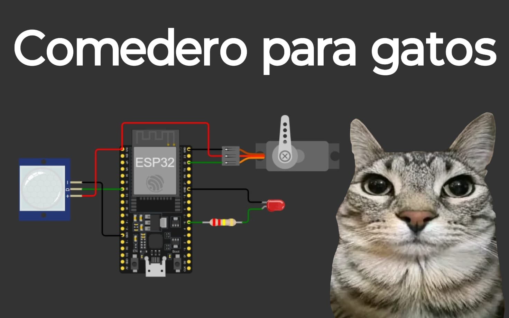
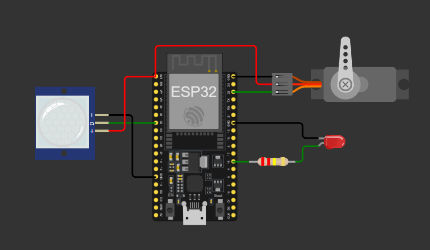

# Comedero Inteligente para Gatos
Proyecto del curso EL-1200 Introducción a la Electrónica, TEC, II semestre 2026.
**Integrantes:** Santiago Montiel Desantti
## Descripción
Comedero automático que dispensa alimento solo cuando detecta al gato
y evita servir de más si el gato se queda frente al plato.
## Funcionamiento
- El sensor PIR detecta la presencia del gato.
- El servomotor abre la compuerta 1,5 s y la vuelve a cerrar.
- El LED indica que se está sirviendo.
- Una variable booleana (dispensado) evita que se sirva otra vez
 mientras el gato sigue ahí.
## Conexiones
| Componente | Pin del ESP32 |
|-----------------|---------------|
| Sensor PIR | GPIO 32 |
| Servomotor | GPIO 22 |
| LED (con 220 Ω) | GPIO 16 |
| Alimentación | 3V3 y GND |

## Simulación
Proyecto en Wokwi: [<enlace público>](https://wokwi.com/projects/479525175305420801)
## Código
Ver la carpeta firmware/. Biblioteca usada: ESP32Servo.
## Evidencia
  <video src="media/funcionamiento.mp4" width="100%" controls></video>
## Mejoras futuras
- Modificar el dispensador inteligente conectándolo a un reloj en vez de a un sensor de movimiento. Así lograremos dispensar la comida de forma más eficiente, evitando que se active cada vez que termine el delay y el gato se vuelva a acercar
